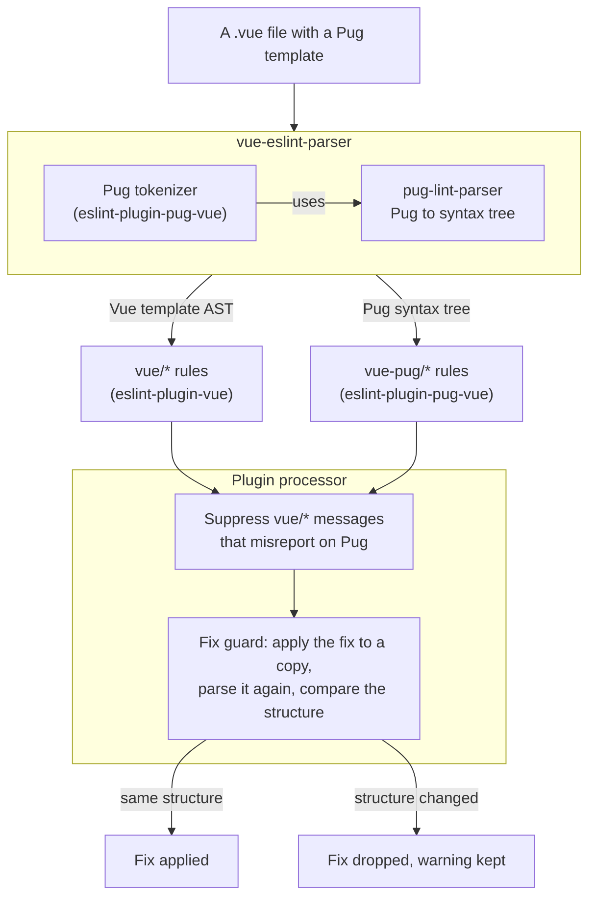

<div align="center">

<sub>[English](../../README.md) | [Tiếng Việt](../vi/README.md) | [한국어](../ko/README.md) | [简体中文](../zh/README.md) | [日本語](../ja/README.md) | **Deutsch** | [Français](../fr/README.md) | [Español](../es/README.md) | [हिन्दी](../hi/README.md) | [Português (Brasil)](../pt/README.md) | [Русский](../ru/README.md)</sub>

<br>

<a href="https://pug-lint.dev/de/">
  
</a>

<br>
<br>

[](https://www.npmjs.com/package/eslint-plugin-pug-vue)
[](https://www.npmjs.com/package/eslint-plugin-pug-vue)
[](https://github.com/HQCuong/pug-lint/actions/workflows/ci.yml)
[](../../LICENSE)

**[Dokumentation](https://pug-lint.dev/de/)** ·
[Erste Schritte](https://pug-lint.dev/de/guide/getting-started) ·
[Regeln](https://pug-lint.dev/de/rules/) ·
[Umstieg von eslint-plugin-vue-pug](https://pug-lint.dev/de/guide/migration)

</div>

---

> Diese Übersetzung kann hinter der englischen Fassung zurückliegen. Bei Abweichungen ist die [englische Fassung](../../README.md) maßgeblich.

`<template lang="pug">` in Vue-Single-File-Components mit ESLint linten und formatieren.

## Funktionen

- **Ihre `vue/*`-Regeln laufen auf Pug.** Die Regeln von eslint-plugin-vue prüfen Pug-Templates unter
  ihren gewohnten Namen und Optionen. Die wenigen, die auf Pug nicht funktionieren können, werden
  abgeschaltet oder nur innerhalb von Pug-Templates stummgeschaltet, sodass Ihre HTML-Templates
  abgedeckt bleiben.
- **Formatieren mit `eslint --fix`.** Zwölf kleine [`vue-pug/*`-Regeln](https://pug-lint.dev/de/rules/)
  kümmern sich um Einrückung, Attributabstände, Kommas, Anführungszeichen und Zeilenumbrüche sowie
  um die Kurzschreibweisen `.class` / `#id`. Kein Prettier und kein zweiter Formatter, der beim
  Speichern gegen ESLint arbeitet.
- **Fixes, die kein Template kaputt machen.** Jeder Fix, der ein Pug-Template berührt, wird geparst
  und mit dem Original verglichen, bevor ESLint ihn schreibt, egal von welcher Regel er kommt. Ein
  Fix, der die Struktur ändern würde, wird verworfen, und seine Warnung bleibt.
  [So funktioniert es](https://pug-lint.dev/de/guide/fix-guard).
- **Funktioniert dort, wo Sie schon linten.** `eslint` in der CLI, Fix beim Speichern in VS Code oder
  in jedem Editor, der ESLint ausführt. ESLint 9 und 10, Flat Config, `lang="pug"` und
  `lang="jade"`. Sie nutzen oxlint? Führen Sie es neben ESLint aus:
  [Mit oxlint verwenden](https://pug-lint.dev/de/guide/oxlint).

```vue
<!-- before: eslint --fix -->
<template lang="pug">
div.card( class="shadow" , :title = "title" )
    h2( v-if='title' ) {{ title }}
    input(v-model="name" , type='text' disabled)/
</template>

<!-- after -->
<template lang="pug">
.card.shadow(:title="title")
  h2(v-if="title") {{ title }}
  input(v-model="name" type="text" disabled)
</template>
```

## Installation

```sh
npm install --save-dev eslint eslint-plugin-vue vue-eslint-parser eslint-plugin-pug-vue
```

Voraussetzungen: Node.js `^22.13.0 || >=24`, ESLint `^9.15.0 || ^10.0.0` mit Flat Config,
eslint-plugin-vue `^10` und vue-eslint-parser `^10`.

## Schnellstart

```js
// eslint.config.js
import pluginVue from 'eslint-plugin-vue'
import vuePug from 'eslint-plugin-pug-vue'

export default [
  ...pluginVue.configs['flat/recommended'],
  ...vuePug.configs.recommended, // after the eslint-plugin-vue configs
]
```

Führen Sie dann `npx eslint . --fix` aus oder
[richten Sie den Fix beim Speichern](https://pug-lint.dev/de/guide/editor-setup) in Ihrem Editor ein.

## So funktioniert es



1. **Parsen.** vue-eslint-parser übergibt jedes `<template lang="pug">` an den Tokenizer des
   Plugins, der es mit `pug-lint-parser` parst und die Tokens zurückgibt, die Vue von HTML erwartet,
   an den exakten Positionen Ihres Pugs.
2. **Linten.** `vue/*`-Regeln lesen den Vue-Template-AST wie bei einem HTML-Template; `vue-pug/*`-Regeln
   lesen den Pug-Syntaxbaum, der die Einrückung, Anführungszeichen und Kommas behält, die sie
   formatieren.
3. **Prüfen.** Bevor ESLint etwas schreibt, verwirft der Prozessor die wenigen `vue/*`-Meldungen, die
   auf Pug falsch sind, und der Fix-Guard lehnt jeden Fix ab, der die Struktur des Templates
   ändern würde.

Mehr unter [So funktioniert es](https://pug-lint.dev/de/guide/how-it-works).

## Pakete

| Paket | Version | Was es ist |
|---|---|---|
| [`eslint-plugin-pug-vue`](../../packages/eslint-plugin) | [](https://www.npmjs.com/package/eslint-plugin-pug-vue) | Das ESLint-Plugin. Installieren Sie dieses. |
| [`pug-lint-parser`](../../packages/pug-parser) | [](https://www.npmjs.com/package/pug-lint-parser) | Der Pug-Parser dahinter: ein konkreter Syntaxbaum mit exakten Quellbereichen, der nie einen Fehler wirft. Wird mit dem Plugin installiert; verwenden Sie ihn nur direkt, um eigene Pug-Werkzeuge zu bauen. |

## Mitwirken

Fehlerberichte, Korrekturen an der Dokumentation und Pull Requests sind willkommen. Einrichtung und
die auszuführenden Prüfungen stehen in [CONTRIBUTING.md](../de/CONTRIBUTING.md); bitte beachten Sie
den [Verhaltenskodex](../de/CODE_OF_CONDUCT.md). Sicherheitslücken: siehe [SECURITY.md](../de/SECURITY.md).

## Lizenz

[MIT](../../LICENSE). Nicht mit den Projekten Pug oder Vue verbunden.
