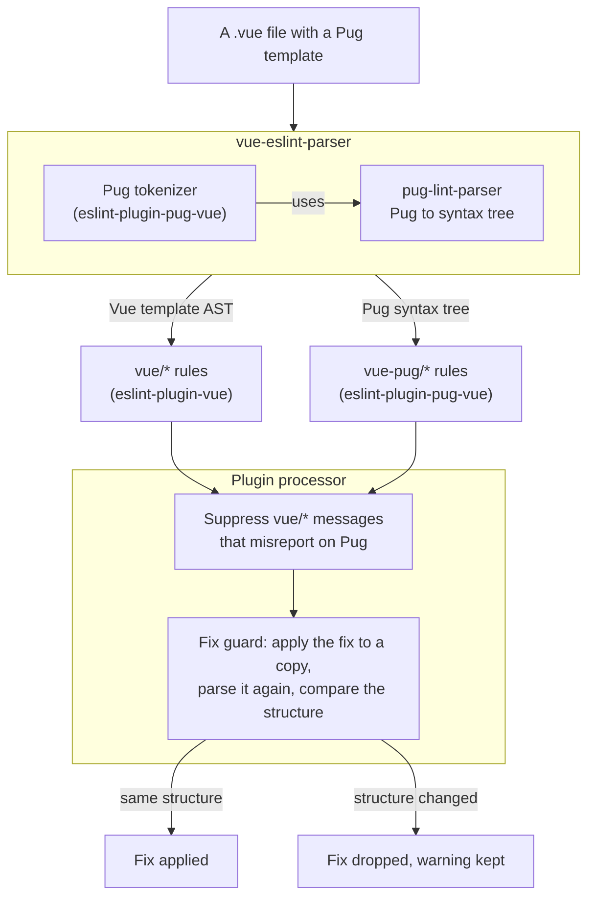

<div align="center">

<sub>[English](../../README.md) | [Tiếng Việt](../vi/README.md) | [한국어](../ko/README.md) | [简体中文](../zh/README.md) | [日本語](../ja/README.md) | [Deutsch](../de/README.md) | [Français](../fr/README.md) | **Español** | [हिन्दी](../hi/README.md) | [Português (Brasil)](../pt/README.md) | [Русский](../ru/README.md)</sub>

<br>

<a href="https://pug-lint.dev/es/">
  
</a>

<br>
<br>

[](https://www.npmjs.com/package/eslint-plugin-pug-vue)
[](https://www.npmjs.com/package/eslint-plugin-pug-vue)
[](https://github.com/HQCuong/pug-lint/actions/workflows/ci.yml)
[](../../LICENSE)

**[Documentación](https://pug-lint.dev/es/)** ·
[Primeros pasos](https://pug-lint.dev/es/guide/getting-started) ·
[Reglas](https://pug-lint.dev/es/rules/) ·
[Migrar desde eslint-plugin-vue-pug](https://pug-lint.dev/es/guide/migration)

</div>

---

> Esta traducción puede ir por detrás de la versión en inglés. En caso de discrepancia, prevalece la [versión en inglés](../../README.md).

Analiza y da formato a `<template lang="pug">` en componentes de un solo archivo de Vue con ESLint.

## Características

- **Tus reglas `vue/*` se ejecutan sobre Pug.** Las reglas de eslint-plugin-vue comprueban las
  plantillas Pug con sus nombres y opciones habituales. Las pocas que no pueden funcionar sobre Pug
  se desactivan o se silencian solo dentro de las plantillas Pug, así que tus plantillas HTML
  siguen cubiertas.
- **Formato con `eslint --fix`.** Doce pequeñas [reglas `vue-pug/*`](https://pug-lint.dev/es/rules/)
  se ocupan de la indentación, el espaciado de atributos, las comas, las comillas y los saltos de
  línea, y de los atajos `.class` / `#id`. Sin Prettier, y sin un segundo formateador que pelee con
  ESLint al guardar.
- **Correcciones que no pueden romper una plantilla.** Cada corrección que toca una plantilla Pug
  se analiza y se compara con el original antes de que ESLint la escriba, sea cual sea la regla de
  la que venga. Una corrección que cambiaría la estructura se descarta y su advertencia permanece.
  [Cómo funciona](https://pug-lint.dev/es/guide/fix-guard).
- **Funciona donde ya haces lint.** `eslint` en la CLI, corrección al guardar en VS Code o en
  cualquier editor que ejecute ESLint. ESLint 9 y 10, configuración flat, `lang="pug"` y
  `lang="jade"`. ¿Usas oxlint? Ejecútalo junto a ESLint: [Uso con oxlint](https://pug-lint.dev/es/guide/oxlint).

```vue
<!-- before: eslint --fix -->
<template lang="pug">
div.card( class="shadow" , :title = "title" )
    h2( v-if='title' ) {{ title }}
    input(v-model="name" , type='text' disabled)/
</template>

<!-- after -->
<template lang="pug">
.card.shadow(:title="title")
  h2(v-if="title") {{ title }}
  input(v-model="name" type="text" disabled)
</template>
```

## Instalación

```sh
npm install --save-dev eslint eslint-plugin-vue vue-eslint-parser eslint-plugin-pug-vue
```

Requiere Node.js `^22.13.0 || >=24`, ESLint `^9.15.0 || ^10.0.0` con configuración
flat, eslint-plugin-vue `^10` y vue-eslint-parser `^10`.

## Inicio rápido

```js
// eslint.config.js
import pluginVue from 'eslint-plugin-vue'
import vuePug from 'eslint-plugin-pug-vue'

export default [
  ...pluginVue.configs['flat/recommended'],
  ...vuePug.configs.recommended, // after the eslint-plugin-vue configs
]
```

Después ejecuta `npx eslint . --fix`, o
[configura la corrección al guardar](https://pug-lint.dev/es/guide/editor-setup) en tu editor.

## Cómo funciona



1. **Análisis.** vue-eslint-parser entrega cada `<template lang="pug">` al tokenizador del plugin,
   que lo analiza con `pug-lint-parser` y devuelve los tokens que Vue espera de HTML, en las
   posiciones exactas de tu Pug.
2. **Lint.** Las reglas `vue/*` leen el AST de plantilla de Vue como en una plantilla HTML; las
   reglas `vue-pug/*` leen el árbol de sintaxis de Pug, que conserva la indentación, las comillas y
   las comas que formatean.
3. **Comprobación.** Antes de que ESLint escriba nada, el procesador descarta los pocos mensajes de
   `vue/*` que informan mal sobre Pug, y la guarda de correcciones rechaza toda corrección que
   cambie la estructura de la plantilla.

Más en [Cómo funciona](https://pug-lint.dev/es/guide/how-it-works).

## Paquetes

| Paquete | Versión | Qué es |
|---|---|---|
| [`eslint-plugin-pug-vue`](../../packages/eslint-plugin) | [](https://www.npmjs.com/package/eslint-plugin-pug-vue) | El plugin de ESLint. Instala este. |
| [`pug-lint-parser`](../../packages/pug-parser) | [](https://www.npmjs.com/package/pug-lint-parser) | El parser de Pug que hay detrás: un árbol de sintaxis concreto con rangos de código fuente exactos que nunca lanza excepciones. Se instala con el plugin; úsalo directamente solo para construir tus propias herramientas de Pug. |

## Contribuir

Los informes de errores, las correcciones de documentación y las pull requests son bienvenidos.
Consulta [CONTRIBUTING.md](./CONTRIBUTING.md) para la configuración y las comprobaciones que hay que
ejecutar, y sigue el [código de conducta](./CODE_OF_CONDUCT.md). Para los problemas de seguridad,
consulta [SECURITY.md](./SECURITY.md).

## Licencia

[MIT](../../LICENSE). Sin afiliación con los proyectos Pug ni Vue.
