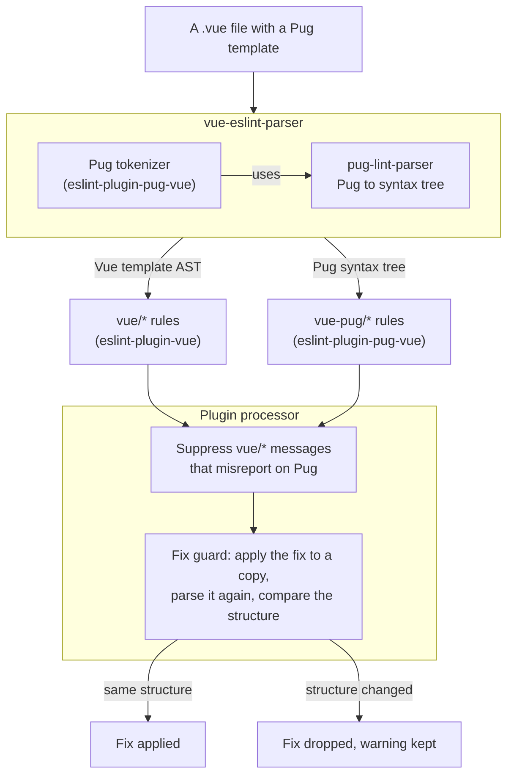

<div align="center">

<sub>[English](../../README.md) | [Tiếng Việt](../vi/README.md) | [한국어](../ko/README.md) | [简体中文](../zh/README.md) | [日本語](../ja/README.md) | [Deutsch](../de/README.md) | **Français** | [Español](../es/README.md) | [हिन्दी](../hi/README.md) | [Português (Brasil)](../pt/README.md) | [Русский](../ru/README.md)</sub>

<br>

<a href="https://pug-lint.dev/fr/">
  
</a>

<br>
<br>

[](https://www.npmjs.com/package/eslint-plugin-pug-vue)
[](https://www.npmjs.com/package/eslint-plugin-pug-vue)
[](https://github.com/HQCuong/pug-lint/actions/workflows/ci.yml)
[](../../LICENSE)

**[Documentation](https://pug-lint.dev/fr/)** ·
[Prise en main](https://pug-lint.dev/fr/guide/getting-started) ·
[Règles](https://pug-lint.dev/fr/rules/) ·
[Migrer depuis eslint-plugin-vue-pug](https://pug-lint.dev/fr/guide/migration)

</div>

---

> Cette traduction peut être en retard sur la version anglaise. En cas de divergence, la [version anglaise](../../README.md) fait foi.

Linter et formater `<template lang="pug">` dans les composants monofichiers Vue avec ESLint.

## Fonctionnalités

- **Vos règles `vue/*` s'exécutent sur Pug.** Les règles d'eslint-plugin-vue vérifient les templates
  Pug sous leurs noms et options habituels. Les quelques-unes qui ne peuvent pas fonctionner sur Pug
  sont désactivées ou réduites au silence dans les templates Pug uniquement, de sorte que vos
  templates HTML restent couverts.
- **Formatage avec `eslint --fix`.** Douze petites [règles `vue-pug/*`](https://pug-lint.dev/fr/rules/)
  gèrent l'indentation, l'espacement des attributs, les virgules, les guillemets et les sauts de
  ligne, ainsi que les raccourcis `.class` / `#id`. Pas de Prettier, et pas de second formateur qui
  se bat avec ESLint à l'enregistrement.
- **Des corrections qui ne peuvent pas casser un template.** Toute correction qui touche un template
  Pug est analysée et comparée à l'original avant qu'ESLint ne l'écrive, quelle que soit la règle
  dont elle provient. Une correction qui changerait la structure est écartée et son avertissement
  reste. [Comment ça marche](https://pug-lint.dev/fr/guide/fix-guard).
- **Fonctionne là où vous lintez déjà.** `eslint` en CLI, correction à l'enregistrement dans VS Code
  ou dans tout éditeur qui exécute ESLint. ESLint 9 et 10, flat config, `lang="pug"` et
  `lang="jade"`. Vous utilisez oxlint ? Lancez-le à côté d'ESLint :
  [Utilisation avec oxlint](https://pug-lint.dev/fr/guide/oxlint).

```vue
<!-- before: eslint --fix -->
<template lang="pug">
div.card( class="shadow" , :title = "title" )
    h2( v-if='title' ) {{ title }}
    input(v-model="name" , type='text' disabled)/
</template>

<!-- after -->
<template lang="pug">
.card.shadow(:title="title")
  h2(v-if="title") {{ title }}
  input(v-model="name" type="text" disabled)
</template>
```

## Installation

```sh
npm install --save-dev eslint eslint-plugin-vue vue-eslint-parser eslint-plugin-pug-vue
```

Nécessite Node.js `^20.19.0 || ^22.13.0 || >=24`, ESLint `^9.15.0 || ^10.0.0` avec une flat config,
eslint-plugin-vue `^10` et vue-eslint-parser `^10`.

## Démarrage rapide

```js
// eslint.config.js
import pluginVue from 'eslint-plugin-vue'
import vuePug from 'eslint-plugin-pug-vue'

export default [
  ...pluginVue.configs['flat/recommended'],
  ...vuePug.configs.recommended, // after the eslint-plugin-vue configs
]
```

Lancez ensuite `npx eslint . --fix`, ou
[configurez la correction à l'enregistrement](https://pug-lint.dev/fr/guide/editor-setup) dans votre éditeur.

## Fonctionnement



1. **Analyser.** vue-eslint-parser confie chaque `<template lang="pug">` au tokenizer du plugin, qui
   l'analyse avec `pug-lint-parser` et renvoie les tokens que Vue attend du HTML, aux positions
   exactes de votre Pug.
2. **Linter.** Les règles `vue/*` lisent l'AST du template Vue comme sur un template HTML ; les
   règles `vue-pug/*` lisent l'arbre syntaxique Pug, qui conserve l'indentation, les guillemets et
   les virgules qu'elles formatent.
3. **Vérifier.** Avant qu'ESLint n'écrive quoi que ce soit, le processor écarte les quelques messages
   `vue/*` erronés sur Pug, et le fix guard rejette toute correction qui changerait la structure du
   template.

Plus de détails dans [Fonctionnement](https://pug-lint.dev/fr/guide/how-it-works).

## Packages

| Package | Version | Ce que c'est |
|---|---|---|
| [`eslint-plugin-pug-vue`](../../packages/eslint-plugin) | [](https://www.npmjs.com/package/eslint-plugin-pug-vue) | Le plugin ESLint. C'est celui-ci qu'il faut installer. |
| [`pug-lint-parser`](../../packages/pug-parser) | [](https://www.npmjs.com/package/pug-lint-parser) | Le parser Pug qui est derrière : un arbre syntaxique concret avec des plages de source exactes, qui ne lève jamais d'exception. Installé avec le plugin ; à utiliser directement seulement pour construire vos propres outils Pug. |

## Contribuer

Les signalements de bugs, corrections de documentation et pull requests sont les bienvenus. Voir
[CONTRIBUTING.md](./CONTRIBUTING.md) pour la configuration et les vérifications à lancer, et
respectez le [code de conduite](./CODE_OF_CONDUCT.md). Failles de sécurité : voir
[SECURITY.md](./SECURITY.md).

## Licence

[MIT](../../LICENSE). Sans affiliation avec les projets Pug ou Vue.
