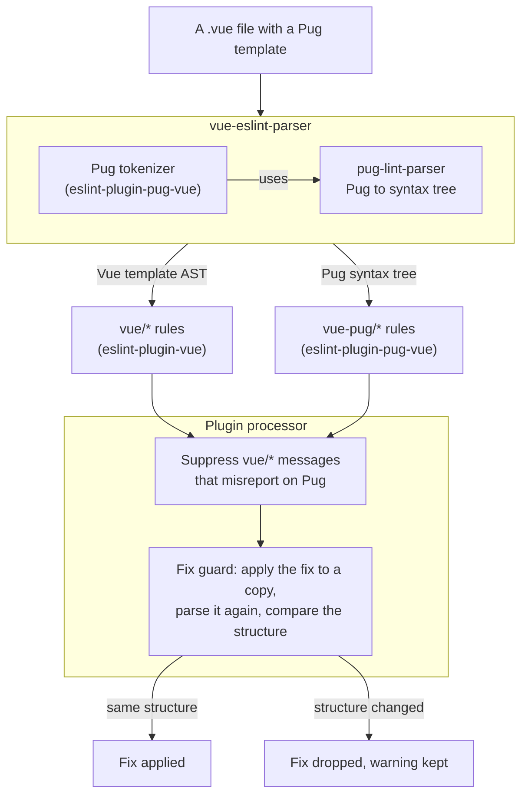

<div align="center">

<sub>[English](../../README.md) | [Tiếng Việt](../vi/README.md) | [한국어](../ko/README.md) | [简体中文](../zh/README.md) | [日本語](../ja/README.md) | [Deutsch](../de/README.md) | [Français](../fr/README.md) | [Español](../es/README.md) | **हिन्दी** | [Português (Brasil)](../pt/README.md) | [Русский](../ru/README.md)</sub>

<br>

<a href="https://pug-lint.dev/hi/">
  
</a>

<br>
<br>

[](https://www.npmjs.com/package/eslint-plugin-pug-vue)
[](https://www.npmjs.com/package/eslint-plugin-pug-vue)
[](https://github.com/HQCuong/pug-lint/actions/workflows/ci.yml)
[](../../LICENSE)

**[दस्तावेज़](https://pug-lint.dev/hi/)** ·
[शुरुआत करें](https://pug-lint.dev/hi/guide/getting-started) ·
[Rules](https://pug-lint.dev/hi/rules/) ·
[eslint-plugin-vue-pug से माइग्रेट करना](https://pug-lint.dev/hi/guide/migration)

</div>

---

> यह अनुवाद अंग्रेज़ी संस्करण से पीछे हो सकता है। किसी भी अंतर की स्थिति में [अंग्रेज़ी संस्करण](../../README.md) ही मान्य है।

ESLint से Vue single-file components में `<template lang="pug">` को lint और format करें।

## विशेषताएँ

- **आपके `vue/*` rules Pug पर चलते हैं।** eslint-plugin-vue के rules Pug templates को अपने सामान्य
  नामों और options के साथ जाँचते हैं। जो थोड़े-से rules Pug पर काम नहीं कर सकते उन्हें बंद कर दिया जाता है या केवल Pug
  templates के अंदर चुप कराया जाता है, इसलिए आपके HTML templates कवर रहते हैं।
- **`eslint --fix` से formatting।** बारह छोटे [`vue-pug/*` rules](https://pug-lint.dev/hi/rules/)
  indentation, attribute spacing, commas, quotes और line breaks, तथा `.class` / `#id`
  shorthands संभालते हैं। न Prettier, और न कोई दूसरा formatter जो save करते समय ESLint से टकराए।
- **ऐसे fixes जो template को नहीं तोड़ सकते।** Pug template को छूने वाला हर fix, चाहे किसी भी rule से आया हो, ESLint के लिखने से पहले
  parse होता है और मूल से तुलना किया जाता है। जो fix structure बदल दे वह हटा दिया जाता है और उसकी चेतावनी बनी रहती है।
  [यह कैसे काम करता है](https://pug-lint.dev/hi/guide/fix-guard)।
- **वहीं काम करता है जहाँ आप पहले से lint करते हैं।** CLI पर `eslint`, VS Code में fix-on-save या ESLint चलाने वाला कोई भी editor।
  ESLint 9 और 10, flat config, `lang="pug"` और `lang="jade"`। oxlint उपयोग करते हैं? उसे ESLint के साथ चलाएँ:
  [oxlint के साथ उपयोग](https://pug-lint.dev/hi/guide/oxlint)।

```vue
<!-- before: eslint --fix -->
<template lang="pug">
div.card( class="shadow" , :title = "title" )
    h2( v-if='title' ) {{ title }}
    input(v-model="name" , type='text' disabled)/
</template>

<!-- after -->
<template lang="pug">
.card.shadow(:title="title")
  h2(v-if="title") {{ title }}
  input(v-model="name" type="text" disabled)
</template>
```

## Installation

```sh
npm install --save-dev eslint eslint-plugin-vue vue-eslint-parser eslint-plugin-pug-vue
```

Node.js `^22.13.0 || >=24`, flat config वाला ESLint `^9.15.0 || ^10.0.0`,
eslint-plugin-vue `^10` और vue-eslint-parser `^10` चाहिए।

## Quick start

```js
// eslint.config.js
import pluginVue from 'eslint-plugin-vue'
import vuePug from 'eslint-plugin-pug-vue'

export default [
  ...pluginVue.configs['flat/recommended'],
  ...vuePug.configs.recommended, // after the eslint-plugin-vue configs
]
```

फिर `npx eslint . --fix` चलाएँ, या अपने editor में
[fix-on-save सेट करें](https://pug-lint.dev/hi/guide/editor-setup)।

## यह कैसे काम करता है



1. **Parse।** vue-eslint-parser हर `<template lang="pug">` को plugin के tokenizer को सौंपता है,
   जो उसे `pug-lint-parser` से parse करता है और वे tokens लौटाता है जिनकी Vue को HTML से अपेक्षा होती है, आपके Pug की
   सटीक positions पर।
2. **Lint।** `vue/*` rules Vue template AST को वैसे ही पढ़ते हैं जैसे HTML template पर; `vue-pug/*` rules
   Pug syntax tree पढ़ते हैं, जो वह indentation, quotes और commas रखता है जिन्हें वे format करते हैं।
3. **Check।** ESLint के कुछ भी लिखने से पहले, processor उन थोड़े `vue/*` संदेशों को हटाता है जो Pug पर
   गलत रिपोर्ट करते हैं, और fix guard हर वह fix अस्वीकार करता है जो template का
   structure बदल दे।

और जानकारी [यह कैसे काम करता है](https://pug-lint.dev/hi/guide/how-it-works) में।

## Packages

| Package | Version | यह क्या है |
|---|---|---|
| [`eslint-plugin-pug-vue`](../../packages/eslint-plugin) | [](https://www.npmjs.com/package/eslint-plugin-pug-vue) | ESLint plugin। इसे install करें। |
| [`pug-lint-parser`](../../packages/pug-parser) | [](https://www.npmjs.com/package/pug-lint-parser) | इसके पीछे का Pug parser: सटीक source ranges वाला concrete syntax tree जो कभी throw नहीं करता। Plugin के साथ install होता है; इसे सीधे केवल तब उपयोग करें जब आप अपना Pug tooling बना रहे हों। |

## योगदान

Bug reports, docs सुधार और pull requests का स्वागत है। Setup और चलाने योग्य checks के लिए [CONTRIBUTING.md](./CONTRIBUTING.md) देखें, और
[आचार संहिता](./CODE_OF_CONDUCT.md) का पालन करें। सुरक्षा
संबंधी समस्याओं के लिए: [SECURITY.md](./SECURITY.md) देखें।

## License

[MIT](../../LICENSE)। Pug या Vue projects से संबद्ध नहीं।
