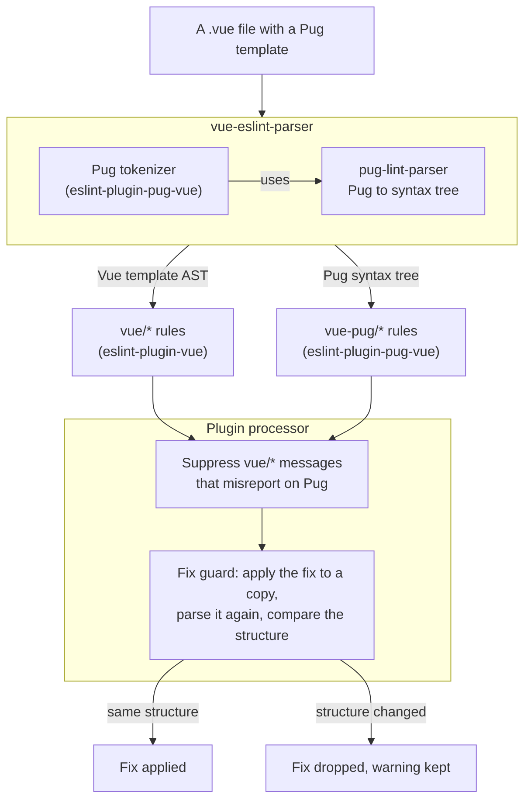

<div align="center">

<sub>[English](../../README.md) | [Tiếng Việt](../vi/README.md) | [한국어](../ko/README.md) | [简体中文](../zh/README.md) | **日本語** | [Deutsch](../de/README.md) | [Français](../fr/README.md) | [Español](../es/README.md) | [हिन्दी](../hi/README.md) | [Português (Brasil)](../pt/README.md) | [Русский](../ru/README.md)</sub>

<br>

<a href="https://pug-lint.dev/ja/">
  
</a>

<br>
<br>

[](https://www.npmjs.com/package/eslint-plugin-pug-vue)
[](https://www.npmjs.com/package/eslint-plugin-pug-vue)
[](https://github.com/HQCuong/pug-lint/actions/workflows/ci.yml)
[](../../LICENSE)

**[ドキュメント](https://pug-lint.dev/ja/)** ·
[セットアップ](https://pug-lint.dev/ja/guide/getting-started) ·
[ルール](https://pug-lint.dev/ja/rules/) ·
[eslint-plugin-vue-pug からの移行](https://pug-lint.dev/ja/guide/migration)

</div>

---

> この翻訳は英語版より更新が遅れている場合があります。内容に相違がある場合は、[英語版](../../README.md)が正式なものです。

Vue のシングルファイルコンポーネント内の `<template lang="pug">` を、ESLint で lint・整形します。

## 特長

- **`vue/*` rule が Pug 上で動きます。** eslint-plugin-vue の rule が、いつもの名前とオプションのまま Pug テンプレートを検査します。Pug では動作しない一部の rule は、無効にするか、Pug テンプレートの中でだけ出力を抑えるので、HTML テンプレートへのチェックは保たれます。
- **`eslint --fix` による整形。** 12 個の小さな [`vue-pug/*` rule](https://pug-lint.dev/ja/rules/) が、インデント、属性のスペース、カンマ、クォート、改行、そして `.class` / `#id` の省略記法を扱います。Prettier は不要で、保存時に ESLint と競合する別のフォーマッターもありません。
- **テンプレートを壊さない fix。** Pug テンプレートに触れるすべての fix は、どの rule 由来であっても、ESLint が書き込む前にパースされ、元のテンプレートと比較されます。構造を変える fix は破棄され、警告は残ります。[仕組み](https://pug-lint.dev/ja/guide/fix-guard)。
- **今使っている lint の環境でそのまま動きます。** CLI の `eslint`、VS Code の保存時 fix、ESLint を実行するあらゆるエディターで使えます。ESLint 9 と 10、flat config、`lang="pug"` と `lang="jade"` に対応しています。oxlint を使っている場合は、ESLint と並べて実行してください。[oxlint と併用する](https://pug-lint.dev/ja/guide/oxlint)。

```vue
<!-- before: eslint --fix -->
<template lang="pug">
div.card( class="shadow" , :title = "title" )
    h2( v-if='title' ) {{ title }}
    input(v-model="name" , type='text' disabled)/
</template>

<!-- after -->
<template lang="pug">
.card.shadow(:title="title")
  h2(v-if="title") {{ title }}
  input(v-model="name" type="text" disabled)
</template>
```

## インストール

```sh
npm install --save-dev eslint eslint-plugin-vue vue-eslint-parser eslint-plugin-pug-vue
```

Node.js `^20.19.0 || ^22.13.0 || >=24`、flat config を使う ESLint `^9.15.0 || ^10.0.0`、eslint-plugin-vue `^10`、vue-eslint-parser `^10` が必要です。

## クイックスタート

```js
// eslint.config.js
import pluginVue from 'eslint-plugin-vue'
import vuePug from 'eslint-plugin-pug-vue'

export default [
  ...pluginVue.configs['flat/recommended'],
  ...vuePug.configs.recommended, // after the eslint-plugin-vue configs
]
```

そのあと `npx eslint . --fix` を実行するか、エディターで[保存時の fix を設定](https://pug-lint.dev/ja/guide/editor-setup)してください。

## 仕組み



1. **パース。** vue-eslint-parser は、各 `<template lang="pug">` をプラグインのトークナイザーに渡します。トークナイザーは `pug-lint-parser` でそれをパースし、Vue が HTML に期待するトークンを、Pug の正確な位置で返します。
2. **Lint。** `vue/*` rule は、HTML テンプレートの場合と同じように Vue のテンプレート AST を読みます。`vue-pug/*` rule は Pug の構文木を読みます。この木には、それらが整形するインデント、クォート、カンマが残っています。
3. **検証。** ESLint が何かを書き込む前に、processor が Pug で誤検知になる一部の `vue/*` メッセージを取り除き、fix ガードがテンプレートの構造を変えるすべての fix を拒否します。

詳しくは[仕組み](https://pug-lint.dev/ja/guide/how-it-works)を参照してください。

## パッケージ

| パッケージ | バージョン | 内容 |
|---|---|---|
| [`eslint-plugin-pug-vue`](../../packages/eslint-plugin) | [](https://www.npmjs.com/package/eslint-plugin-pug-vue) | ESLint プラグイン本体です。インストールするのはこちらです。 |
| [`pug-lint-parser`](../../packages/pug-parser) | [](https://www.npmjs.com/package/pug-lint-parser) | プラグインの土台になっている Pug パーサーです。正確なソース範囲を持ち、例外を投げない具象構文木を返します。プラグインと一緒にインストールされます。独自の Pug ツールを作る場合にだけ、直接使ってください。 |

## コントリビューション

バグ報告、ドキュメントの修正、プルリクエストを歓迎します。セットアップと実行すべきチェックは [CONTRIBUTING.md](../ja/CONTRIBUTING.md) を参照し、[行動規範](../ja/CODE_OF_CONDUCT.md)に従ってください。セキュリティ上の問題は [SECURITY.md](../ja/SECURITY.md) を参照してください。

## ライセンス

[MIT](../../LICENSE)。Pug および Vue プロジェクトとは関係ありません。
