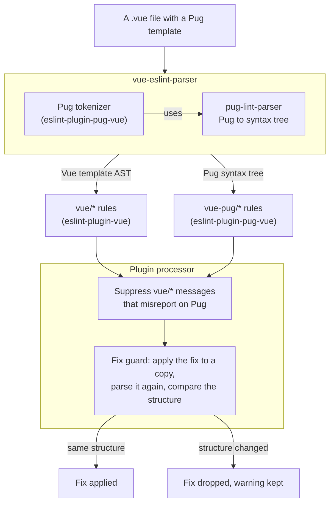

<div align="center">

<sub>[English](../../README.md) | [Tiếng Việt](../vi/README.md) | **한국어** | [简体中文](../zh/README.md) | [日本語](../ja/README.md) | [Deutsch](../de/README.md) | [Français](../fr/README.md) | [Español](../es/README.md) | [हिन्दी](../hi/README.md) | [Português (Brasil)](../pt/README.md) | [Русский](../ru/README.md)</sub>

<br>

<a href="https://pug-lint.dev/ko/">
  
</a>

<br>
<br>

[](https://www.npmjs.com/package/eslint-plugin-pug-vue)
[](https://www.npmjs.com/package/eslint-plugin-pug-vue)
[](https://github.com/HQCuong/pug-lint/actions/workflows/ci.yml)
[](../../LICENSE)

**[문서](https://pug-lint.dev/ko/)** ·
[시작하기](https://pug-lint.dev/ko/guide/getting-started) ·
[규칙](https://pug-lint.dev/ko/rules/) ·
[eslint-plugin-vue-pug에서 마이그레이션](https://pug-lint.dev/ko/guide/migration)

</div>

---

> 이 번역은 영어 원문보다 늦게 갱신될 수 있습니다. 내용이 다를 경우 [영어 원문](../../README.md)이 기준입니다.

ESLint로 Vue 단일 파일 컴포넌트의 `<template lang="pug">`를 lint하고 포맷합니다.

## 기능

- **`vue/*` 규칙이 Pug에서도 동작합니다.** eslint-plugin-vue 규칙이 기존과 같은 이름과 옵션으로 Pug 템플릿을
  검사합니다. Pug에서 동작할 수 없는 소수의 규칙은 꺼지거나 Pug 템플릿 안에서만 무시되므로, HTML 템플릿은 계속
  검사됩니다.
- **`eslint --fix`로 포맷합니다.** 작은 [`vue-pug/*` 규칙](https://pug-lint.dev/ko/rules/) 열두 개가 들여쓰기,
  속성 공백, 쉼표, 따옴표, 줄바꿈, 그리고 `.class` / `#id` 축약 표기를 다룹니다. Prettier도, 저장할 때 ESLint와
  충돌하는 두 번째 포매터도 필요 없습니다.
- **템플릿을 깨뜨릴 수 없는 fix.** Pug 템플릿을 건드리는 모든 fix는 ESLint가 쓰기 전에, 어떤 규칙에서 나온 것이든
  파싱해서 원본과 비교합니다. 구조를 바꾸는 fix는 버려지고 경고는 남습니다.
  [동작 방식](https://pug-lint.dev/ko/guide/fix-guard).
- **이미 lint하는 곳에서 그대로 동작합니다.** CLI의 `eslint`, VS Code나 ESLint를 실행하는 모든 에디터의 저장 시
  fix. ESLint 9와 10, flat config, `lang="pug"`와 `lang="jade"`를 지원합니다. oxlint를 쓰시나요? ESLint와 함께
  실행하세요: [oxlint와 함께 사용하기](https://pug-lint.dev/ko/guide/oxlint).

```vue
<!-- before: eslint --fix -->
<template lang="pug">
div.card( class="shadow" , :title = "title" )
    h2( v-if='title' ) {{ title }}
    input(v-model="name" , type='text' disabled)/
</template>

<!-- after -->
<template lang="pug">
.card.shadow(:title="title")
  h2(v-if="title") {{ title }}
  input(v-model="name" type="text" disabled)
</template>
```

## 설치

```sh
npm install --save-dev eslint eslint-plugin-vue vue-eslint-parser eslint-plugin-pug-vue
```

Node.js `^22.13.0 || >=24`, flat config를 쓰는 ESLint `^9.15.0 || ^10.0.0`, eslint-plugin-vue
`^10`, vue-eslint-parser `^10`이 필요합니다.

## 빠른 시작

```js
// eslint.config.js
import pluginVue from 'eslint-plugin-vue'
import vuePug from 'eslint-plugin-pug-vue'

export default [
  ...pluginVue.configs['flat/recommended'],
  ...vuePug.configs.recommended, // after the eslint-plugin-vue configs
]
```

그런 다음 `npx eslint . --fix`를 실행하거나, 에디터에
[저장 시 fix를 설정](https://pug-lint.dev/ko/guide/editor-setup)하세요.

## 동작 방식



1. **파싱.** vue-eslint-parser가 각 `<template lang="pug">`를 플러그인의 tokenizer에 넘기면, tokenizer는
   `pug-lint-parser`로 이를 파싱해 Vue가 HTML에서 기대하는 token을 Pug의 정확한 위치에 만들어 돌려줍니다.
2. **Lint.** `vue/*` 규칙은 HTML 템플릿에서처럼 Vue 템플릿 AST를 읽고, `vue-pug/*` 규칙은 Pug 구문 트리를
   읽습니다. 이 트리에는 규칙이 포맷하는 들여쓰기, 따옴표, 쉼표가 남아 있습니다.
3. **검사.** ESLint가 무언가를 쓰기 전에 processor가 Pug에서 잘못 보고하는 소수의 `vue/*` 메시지를 제거하고,
   fix guard가 템플릿의 구조를 바꾸는 모든 fix를 거부합니다.

자세한 내용은 [동작 방식](https://pug-lint.dev/ko/guide/how-it-works)을 참고하세요.

## 패키지

| 패키지 | 버전 | 설명 |
|---|---|---|
| [`eslint-plugin-pug-vue`](../../packages/eslint-plugin) | [](https://www.npmjs.com/package/eslint-plugin-pug-vue) | ESLint 플러그인. 이 패키지를 설치하세요. |
| [`pug-lint-parser`](../../packages/pug-parser) | [](https://www.npmjs.com/package/pug-lint-parser) | 그 바탕이 되는 Pug 파서: 정확한 소스 범위를 가진 구체 구문 트리를 만들며 예외를 던지지 않습니다. 플러그인과 함께 설치되며, 직접 Pug 도구를 만들 때만 단독으로 사용하세요. |

## 기여하기

버그 리포트, 문서 수정, pull request를 환영합니다. 설정 방법과 실행할 검사는
[CONTRIBUTING.md](./CONTRIBUTING.md)를 보시고, [행동 강령](./CODE_OF_CONDUCT.md)을 따라 주세요. 보안 문제는
[SECURITY.md](./SECURITY.md)를 참고하세요.

## 라이선스

[MIT](../../LICENSE). Pug 또는 Vue 프로젝트와 관련이 없습니다.
