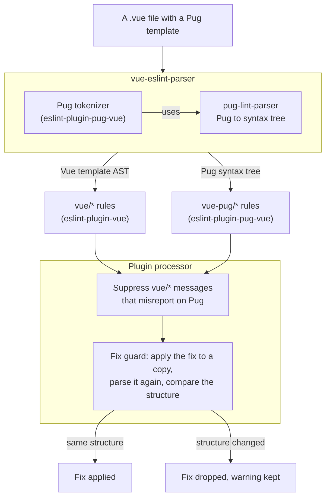

<div align="center">

<sub>[English](../../README.md) | [Tiếng Việt](../vi/README.md) | [한국어](../ko/README.md) | [简体中文](../zh/README.md) | [日本語](../ja/README.md) | [Deutsch](../de/README.md) | [Français](../fr/README.md) | [Español](../es/README.md) | [हिन्दी](../hi/README.md) | **Português (Brasil)** | [Русский](../ru/README.md)</sub>

<br>

<a href="https://pug-lint.dev/pt/">
  
</a>

<br>
<br>

[](https://www.npmjs.com/package/eslint-plugin-pug-vue)
[](https://www.npmjs.com/package/eslint-plugin-pug-vue)
[](https://github.com/HQCuong/pug-lint/actions/workflows/ci.yml)
[](../../LICENSE)

**[Documentação](https://pug-lint.dev/pt/)** ·
[Primeiros passos](https://pug-lint.dev/pt/guide/getting-started) ·
[Regras](https://pug-lint.dev/pt/rules/) ·
[Migrando do eslint-plugin-vue-pug](https://pug-lint.dev/pt/guide/migration)

</div>

---

> Esta tradução pode estar desatualizada em relação à versão em inglês. Em caso de divergência, prevalece a [versão em inglês](../../README.md).

Lint e formatação de `<template lang="pug">` em componentes Vue de arquivo único com ESLint.

## Recursos

- **Suas regras `vue/*` rodam no Pug.** As regras do eslint-plugin-vue verificam templates Pug com
  os nomes e as opções de sempre. As poucas que não funcionam no Pug são desativadas ou silenciadas
  só dentro de templates Pug, então seus templates HTML continuam cobertos.
- **Formatação com `eslint --fix`.** Doze pequenas [regras `vue-pug/*`](https://pug-lint.dev/pt/rules/)
  cuidam de indentação, espaçamento de atributos, vírgulas, aspas, quebras de linha e dos atalhos
  `.class` / `#id`. Sem Prettier e sem um segundo formatador brigando com o ESLint ao salvar.
- **Correções que não quebram um template.** Toda correção que toca um template Pug é analisada e
  comparada com o original antes de o ESLint gravá-la, qualquer que seja a regra de origem. Uma
  correção que mudaria a estrutura é descartada e seu aviso permanece.
  [Como funciona](https://pug-lint.dev/pt/guide/fix-guard).
- **Funciona onde você já faz lint.** `eslint` na CLI, correção ao salvar no VS Code ou em qualquer
  editor que rode o ESLint. ESLint 9 e 10, flat config, `lang="pug"` e `lang="jade"`. Usa oxlint?
  Rode-o junto com o ESLint: [Uso com o oxlint](https://pug-lint.dev/pt/guide/oxlint).

```vue
<!-- before: eslint --fix -->
<template lang="pug">
div.card( class="shadow" , :title = "title" )
    h2( v-if='title' ) {{ title }}
    input(v-model="name" , type='text' disabled)/
</template>

<!-- after -->
<template lang="pug">
.card.shadow(:title="title")
  h2(v-if="title") {{ title }}
  input(v-model="name" type="text" disabled)
</template>
```

## Instalação

```sh
npm install --save-dev eslint eslint-plugin-vue vue-eslint-parser eslint-plugin-pug-vue
```

Requer Node.js `^20.19.0 || ^22.13.0 || >=24`, ESLint `^9.15.0 || ^10.0.0` com flat config,
eslint-plugin-vue `^10` e vue-eslint-parser `^10`.

## Início rápido

```js
// eslint.config.js
import pluginVue from 'eslint-plugin-vue'
import vuePug from 'eslint-plugin-pug-vue'

export default [
  ...pluginVue.configs['flat/recommended'],
  ...vuePug.configs.recommended, // after the eslint-plugin-vue configs
]
```

Depois rode `npx eslint . --fix`, ou
[configure a correção ao salvar](https://pug-lint.dev/pt/guide/editor-setup) no seu editor.

## Como funciona



1. **Análise.** O vue-eslint-parser entrega cada `<template lang="pug">` ao tokenizer do plugin,
   que o analisa com o `pug-lint-parser` e devolve os tokens que o Vue espera de um HTML, nas
   posições exatas do seu Pug.
2. **Lint.** As regras `vue/*` leem a AST do template do Vue como em um template HTML; as regras
   `vue-pug/*` leem a árvore de sintaxe do Pug, que guarda a indentação, as aspas e as vírgulas que
   elas formatam.
3. **Verificação.** Antes de o ESLint gravar qualquer coisa, o processor descarta as poucas
   mensagens `vue/*` que reportam errado no Pug, e o fix guard rejeita toda correção que mudaria a
   estrutura do template.

Mais em [Como funciona](https://pug-lint.dev/pt/guide/how-it-works).

## Pacotes

| Pacote | Versão | O que é |
|---|---|---|
| [`eslint-plugin-pug-vue`](../../packages/eslint-plugin) | [](https://www.npmjs.com/package/eslint-plugin-pug-vue) | O plugin do ESLint. Instale este. |
| [`pug-lint-parser`](../../packages/pug-parser) | [](https://www.npmjs.com/package/pug-lint-parser) | O parser de Pug por trás dele: uma árvore de sintaxe concreta com ranges exatos no código-fonte, que nunca lança exceção. É instalado junto com o plugin; use-o diretamente só para criar suas próprias ferramentas de Pug. |

## Como contribuir

Relatos de bugs, correções na documentação e pull requests são bem-vindos. Veja
[CONTRIBUTING.md](./CONTRIBUTING.md) para a configuração e os checks a rodar, e siga o
[Código de Conduta](./CODE_OF_CONDUCT.md). Problemas de segurança: veja [SECURITY.md](./SECURITY.md).

## Licença

[MIT](../../LICENSE). Sem afiliação com os projetos Pug ou Vue.
