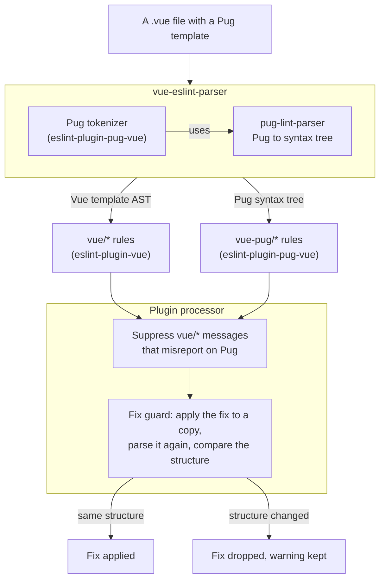

<div align="center">

<sub>[English](../../README.md) | [Tiếng Việt](../vi/README.md) | [한국어](../ko/README.md) | [简体中文](../zh/README.md) | [日本語](../ja/README.md) | [Deutsch](../de/README.md) | [Français](../fr/README.md) | [Español](../es/README.md) | [हिन्दी](../hi/README.md) | [Português (Brasil)](../pt/README.md) | **Русский**</sub>

<br>

<a href="https://pug-lint.dev/ru/">
  
</a>

<br>
<br>

[](https://www.npmjs.com/package/eslint-plugin-pug-vue)
[](https://www.npmjs.com/package/eslint-plugin-pug-vue)
[](https://github.com/HQCuong/pug-lint/actions/workflows/ci.yml)
[](../../LICENSE)

**[Документация](https://pug-lint.dev/ru/)** ·
[Начало работы](https://pug-lint.dev/ru/guide/getting-started) ·
[Правила](https://pug-lint.dev/ru/rules/) ·
[Миграция с eslint-plugin-vue-pug](https://pug-lint.dev/ru/guide/migration)

</div>

---

> Этот перевод может отставать от английской версии. При расхождениях приоритет имеет [английская версия](../../README.md).

Линтинг и форматирование `<template lang="pug">` в однофайловых компонентах Vue с помощью ESLint.

## Возможности

- **Ваши правила `vue/*` работают на Pug.** Правила eslint-plugin-vue проверяют шаблоны Pug под привычными
  именами и с привычными опциями. Те немногие, что не могут работать на Pug, отключены или заглушены только
  внутри шаблонов Pug, так что ваши HTML-шаблоны остаются под проверкой.
- **Форматирование через `eslint --fix`.** Двенадцать небольших [правил `vue-pug/*`](https://pug-lint.dev/ru/rules/)
  отвечают за отступы, пробелы между атрибутами, запятые, кавычки, переносы строк и сокращения
  `.class` / `#id`. Без Prettier и без второго форматировщика, который спорит с ESLint при сохранении.
- **Исправления, которые не могут сломать шаблон.** Каждое исправление, затрагивающее шаблон Pug,
  разбирается и сравнивается с оригиналом до того, как ESLint его запишет, из какого бы правила оно ни
  пришло. Исправление, меняющее структуру, отбрасывается, а предупреждение остаётся.
  [Как это работает](https://pug-lint.dev/ru/guide/fix-guard).
- **Работает там, где вы уже линтите.** `eslint` в CLI, автоисправление при сохранении в VS Code или в
  любом редакторе, запускающем ESLint. ESLint 9 и 10, flat config, `lang="pug"` и `lang="jade"`.
  Используете oxlint? Запускайте его рядом с ESLint: [Использование с oxlint](https://pug-lint.dev/ru/guide/oxlint).

```vue
<!-- before: eslint --fix -->
<template lang="pug">
div.card( class="shadow" , :title = "title" )
    h2( v-if='title' ) {{ title }}
    input(v-model="name" , type='text' disabled)/
</template>

<!-- after -->
<template lang="pug">
.card.shadow(:title="title")
  h2(v-if="title") {{ title }}
  input(v-model="name" type="text" disabled)
</template>
```

## Установка

```sh
npm install --save-dev eslint eslint-plugin-vue vue-eslint-parser eslint-plugin-pug-vue
```

Требуются Node.js `^20.19.0 || ^22.13.0 || >=24`, ESLint `^9.15.0 || ^10.0.0` с flat config,
eslint-plugin-vue `^10` и vue-eslint-parser `^10`.

## Быстрый старт

```js
// eslint.config.js
import pluginVue from 'eslint-plugin-vue'
import vuePug from 'eslint-plugin-pug-vue'

export default [
  ...pluginVue.configs['flat/recommended'],
  ...vuePug.configs.recommended, // after the eslint-plugin-vue configs
]
```

Затем запустите `npx eslint . --fix` или
[настройте автоисправление при сохранении](https://pug-lint.dev/ru/guide/editor-setup) в своём редакторе.

## Как это работает



1. **Разбор.** vue-eslint-parser передаёт каждый `<template lang="pug">` токенизатору плагина, который
   разбирает его через `pug-lint-parser` и возвращает токены, которые Vue ожидает от HTML, в точных
   позициях вашего Pug.
2. **Линтинг.** Правила `vue/*` читают AST шаблона Vue, как на HTML-шаблоне; правила `vue-pug/*` читают
   синтаксическое дерево Pug, которое хранит отступы, кавычки и запятые, которые они форматируют.
3. **Проверка.** Прежде чем ESLint что-либо запишет, процессор отбрасывает те немногие сообщения `vue/*`,
   которые ошибочны для Pug, а защита исправлений отклоняет каждое исправление, которое изменило бы
   структуру шаблона.

Подробнее в разделе [Как это работает](https://pug-lint.dev/ru/guide/how-it-works).

## Пакеты

| Пакет | Версия | Что это |
|---|---|---|
| [`eslint-plugin-pug-vue`](../../packages/eslint-plugin) | [](https://www.npmjs.com/package/eslint-plugin-pug-vue) | Плагин ESLint. Устанавливайте его. |
| [`pug-lint-parser`](../../packages/pug-parser) | [](https://www.npmjs.com/package/pug-lint-parser) | Парсер Pug, на котором он построен: конкретное синтаксическое дерево с точными диапазонами в исходнике, которое никогда не бросает исключений. Устанавливается вместе с плагином; используйте его напрямую, только чтобы построить собственные инструменты для Pug. |

## Участие в проекте

Отчёты об ошибках, исправления документации и pull request'ы приветствуются. Настройку окружения и
проверки, которые нужно запускать, см. в [CONTRIBUTING.md](./CONTRIBUTING.md), и соблюдайте
[кодекс поведения](./CODE_OF_CONDUCT.md). О проблемах безопасности: см. [SECURITY.md](./SECURITY.md).

## Лицензия

[MIT](../../LICENSE). Не связан с проектами Pug и Vue.
