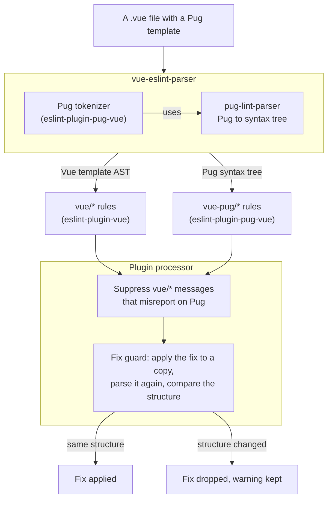

<div align="center">

<sub>[English](../../README.md) | **Tiếng Việt** | [한국어](../ko/README.md) | [简体中文](../zh/README.md) | [日本語](../ja/README.md) | [Deutsch](../de/README.md) | [Français](../fr/README.md) | [Español](../es/README.md) | [हिन्दी](../hi/README.md) | [Português (Brasil)](../pt/README.md) | [Русский](../ru/README.md)</sub>

<br>

<a href="https://pug-lint.dev/vi/">
  
</a>

<br>
<br>

[](https://www.npmjs.com/package/eslint-plugin-pug-vue)
[](https://www.npmjs.com/package/eslint-plugin-pug-vue)
[](https://github.com/HQCuong/pug-lint/actions/workflows/ci.yml)
[](../../LICENSE)

**[Tài liệu](https://pug-lint.dev/vi/)** ·
[Bắt đầu](https://pug-lint.dev/vi/guide/getting-started) ·
[Rule](https://pug-lint.dev/vi/rules/) ·
[Chuyển từ eslint-plugin-vue-pug](https://pug-lint.dev/vi/guide/migration)

</div>

---

> Bản dịch này có thể chậm hơn bản tiếng Anh. Nếu có chỗ không khớp, [bản tiếng Anh](../../README.md) là bản chính thức.

Lint và format `<template lang="pug">` trong Vue single-file component bằng ESLint.

## Tính năng

- **Các rule `vue/*` của bạn chạy được trên Pug.** Rule của eslint-plugin-vue kiểm tra template Pug
  với tên và option quen thuộc. Vài rule không thể hoạt động trên Pug thì bị tắt hoặc chỉ bị im
  lặng bên trong template Pug, nên các template HTML của bạn vẫn được kiểm tra.
- **Format bằng `eslint --fix`.** Mười hai [rule `vue-pug/*`](https://pug-lint.dev/vi/rules/) nhỏ
  lo thụt lề, khoảng trắng giữa attribute, dấu phẩy, dấu nháy và ngắt dòng, cùng shorthand
  `.class` / `#id`. Không Prettier, và không có formatter thứ hai tranh với ESLint khi lưu file.
- **Bản fix không thể làm hỏng template.** Mọi bản fix đụng đến template Pug đều được parse và so
  sánh với bản gốc trước khi ESLint ghi, bất kể đến từ rule nào. Một bản fix làm đổi cấu trúc sẽ bị
  bỏ và cảnh báo của nó vẫn còn.
  [Cách hoạt động](https://pug-lint.dev/vi/guide/fix-guard).
- **Chạy ở nơi bạn vốn đã lint.** `eslint` trên CLI, fix-on-save trong VS Code hoặc bất kỳ editor
  nào chạy ESLint. ESLint 9 và 10, flat config, `lang="pug"` và `lang="jade"`. Đang dùng oxlint?
  Chạy nó cạnh ESLint: [Dùng cùng oxlint](https://pug-lint.dev/vi/guide/oxlint).

```vue
<!-- before: eslint --fix -->
<template lang="pug">
div.card( class="shadow" , :title = "title" )
    h2( v-if='title' ) {{ title }}
    input(v-model="name" , type='text' disabled)/
</template>

<!-- after -->
<template lang="pug">
.card.shadow(:title="title")
  h2(v-if="title") {{ title }}
  input(v-model="name" type="text" disabled)
</template>
```

## Cài đặt

```sh
npm install --save-dev eslint eslint-plugin-vue vue-eslint-parser eslint-plugin-pug-vue
```

Yêu cầu Node.js `^22.13.0 || >=24`, ESLint `^9.15.0 || ^10.0.0` với flat config,
eslint-plugin-vue `^10` và vue-eslint-parser `^10`.

## Bắt đầu nhanh

```js
// eslint.config.js
import pluginVue from 'eslint-plugin-vue'
import vuePug from 'eslint-plugin-pug-vue'

export default [
  ...pluginVue.configs['flat/recommended'],
  ...vuePug.configs.recommended, // after the eslint-plugin-vue configs
]
```

Sau đó chạy `npx eslint . --fix`, hoặc
[thiết lập fix-on-save](https://pug-lint.dev/vi/guide/editor-setup) trong editor của bạn.

## Cách hoạt động



1. **Parse.** vue-eslint-parser giao mỗi `<template lang="pug">` cho tokenizer của plugin, tokenizer
   này parse nó bằng `pug-lint-parser` và trả về các token mà Vue mong đợi từ HTML, tại đúng vị
   trí trong Pug của bạn.
2. **Lint.** Rule `vue/*` đọc AST template của Vue như trên template HTML; rule `vue-pug/*` đọc
   cây cú pháp Pug, nơi giữ lại thụt lề, dấu nháy và dấu phẩy mà chúng format.
3. **Kiểm tra.** Trước khi ESLint ghi bất cứ thứ gì, processor bỏ vài message `vue/*` báo sai trên
   Pug, và fix guard từ chối mọi bản fix làm đổi cấu trúc của template.

Xem thêm trong [Cách hoạt động](https://pug-lint.dev/vi/guide/how-it-works).

## Các package

| Package | Phiên bản | Nó là gì |
|---|---|---|
| [`eslint-plugin-pug-vue`](../../packages/eslint-plugin) | [](https://www.npmjs.com/package/eslint-plugin-pug-vue) | Plugin ESLint. Hãy cài package này. |
| [`pug-lint-parser`](../../packages/pug-parser) | [](https://www.npmjs.com/package/pug-lint-parser) | Parser Pug đứng sau nó: một cây cú pháp cụ thể với source range chính xác và không bao giờ throw. Được cài cùng plugin; chỉ dùng trực tiếp khi bạn xây công cụ Pug của riêng mình. |

## Đóng góp

Luôn hoan nghênh báo lỗi, sửa tài liệu và pull request. Xem [CONTRIBUTING.md](./CONTRIBUTING.md) để
biết cách thiết lập và các bước kiểm tra cần chạy, và tuân theo [Quy tắc ứng xử](./CODE_OF_CONDUCT.md).
Về vấn đề bảo mật: xem [SECURITY.md](./SECURITY.md).

## Giấy phép

[MIT](../../LICENSE). Không liên kết với dự án Pug hay Vue.
