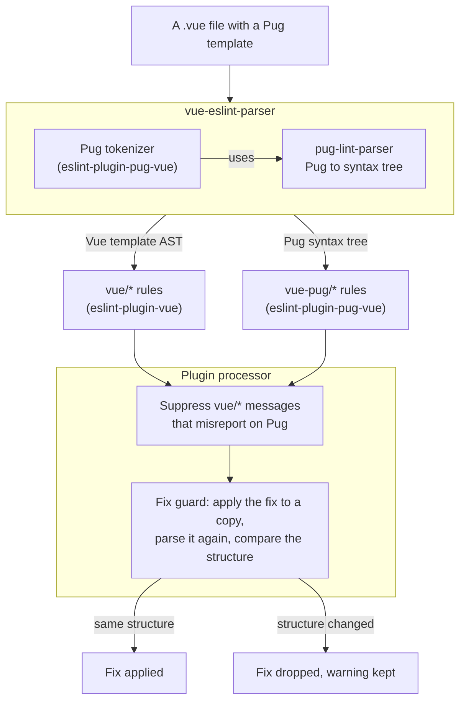

<div align="center">

<sub>[English](../../README.md) | [Tiếng Việt](../vi/README.md) | [한국어](../ko/README.md) | **简体中文** | [日本語](../ja/README.md) | [Deutsch](../de/README.md) | [Français](../fr/README.md) | [Español](../es/README.md) | [हिन्दी](../hi/README.md) | [Português (Brasil)](../pt/README.md) | [Русский](../ru/README.md)</sub>

<br>

<a href="https://pug-lint.dev/zh/">
  
</a>

<br>
<br>

[](https://www.npmjs.com/package/eslint-plugin-pug-vue)
[](https://www.npmjs.com/package/eslint-plugin-pug-vue)
[](https://github.com/HQCuong/pug-lint/actions/workflows/ci.yml)
[](../../LICENSE)

**[文档](https://pug-lint.dev/zh/)** ·
[快速开始](https://pug-lint.dev/zh/guide/getting-started) ·
[规则](https://pug-lint.dev/zh/rules/) ·
[从 eslint-plugin-vue-pug 迁移](https://pug-lint.dev/zh/guide/migration)

</div>

---

> 本译文可能落后于英文版。如有出入，以[英文版](../../README.md)为准。

用 ESLint 对 Vue 单文件组件中的 `<template lang="pug">` 进行 lint 和格式化。

## 特性

- **你的 `vue/*` rules 直接在 Pug 上运行。** eslint-plugin-vue 的 rules 会以原有的名称和选项检查 Pug 模板。少数无法在 Pug 上工作的 rules 会被关闭，或只在 Pug 模板内部被屏蔽，因此你的 HTML 模板仍然受到检查。
- **用 `eslint --fix` 格式化。** 十二个小巧的 [`vue-pug/*` rules](https://pug-lint.dev/zh/rules/)
  负责缩进、属性间距、逗号、引号和换行，以及 `.class` / `#id` 简写。不需要 Prettier，也不会有第二个格式化工具在保存时和 ESLint 打架。
- **不会破坏模板的修复。** 每个涉及 Pug 模板的修复，无论来自哪条 rule，在 ESLint 写入之前都会被解析并与原文比较。会改变结构的修复会被丢弃，警告则保留。
  [工作原理](https://pug-lint.dev/zh/guide/fix-guard)。
- **在你已有的 lint 环境里直接使用。** 命令行的 `eslint`、VS Code 的保存时修复，或任何运行 ESLint 的编辑器。支持 ESLint 9 和 10、flat config、`lang="pug"` 和 `lang="jade"`。在用 oxlint？让它和 ESLint 并行运行：[与 oxlint 搭配使用](https://pug-lint.dev/zh/guide/oxlint)。

```vue
<!-- before: eslint --fix -->
<template lang="pug">
div.card( class="shadow" , :title = "title" )
    h2( v-if='title' ) {{ title }}
    input(v-model="name" , type='text' disabled)/
</template>

<!-- after -->
<template lang="pug">
.card.shadow(:title="title")
  h2(v-if="title") {{ title }}
  input(v-model="name" type="text" disabled)
</template>
```

## 安装

```sh
npm install --save-dev eslint eslint-plugin-vue vue-eslint-parser eslint-plugin-pug-vue
```

需要 Node.js `^22.13.0 || >=24`、使用 flat config 的 ESLint `^9.15.0 || ^10.0.0`、
eslint-plugin-vue `^10` 和 vue-eslint-parser `^10`。

## 快速开始

```js
// eslint.config.js
import pluginVue from 'eslint-plugin-vue'
import vuePug from 'eslint-plugin-pug-vue'

export default [
  ...pluginVue.configs['flat/recommended'],
  ...vuePug.configs.recommended, // after the eslint-plugin-vue configs
]
```

然后运行 `npx eslint . --fix`，或者在编辑器中
[设置保存时修复](https://pug-lint.dev/zh/guide/editor-setup)。

## 工作原理



1. **解析。** vue-eslint-parser 把每个 `<template lang="pug">` 交给插件的 tokenizer，
   后者用 `pug-lint-parser` 解析它，并按你的 Pug 源码中的精确位置，返回 Vue 对 HTML 所期望的 token。
2. **Lint。** `vue/*` rules 像在 HTML 模板上一样读取 Vue 模板 AST；`vue-pug/*` rules
   读取 Pug 语法树，其中保留了它们要格式化的缩进、引号和逗号。
3. **检查。** 在 ESLint 写入任何内容之前，processor 会丢弃少数在 Pug 上误报的 `vue/*` 消息，
   fix guard 会拒绝所有会改变模板结构的修复。

更多内容见[工作原理](https://pug-lint.dev/zh/guide/how-it-works)。

## 包

| 包 | 版本 | 说明 |
|---|---|---|
| [`eslint-plugin-pug-vue`](../../packages/eslint-plugin) | [](https://www.npmjs.com/package/eslint-plugin-pug-vue) | ESLint 插件。安装这个就行。 |
| [`pug-lint-parser`](../../packages/pug-parser) | [](https://www.npmjs.com/package/pug-lint-parser) | 它背后的 Pug 解析器：带精确源码范围、永不抛出异常的具体语法树。会随插件一起安装；只有在构建你自己的 Pug 工具时才需要直接使用。 |

## 参与贡献

欢迎提交 bug 报告、文档修正和 pull request。环境准备和需要运行的检查见 [CONTRIBUTING.md](./CONTRIBUTING.md)，并请遵守[行为准则](./CODE_OF_CONDUCT.md)。安全问题：见 [SECURITY.md](./SECURITY.md)。

## 许可证

[MIT](../../LICENSE)。与 Pug 和 Vue 项目无任何关联。
